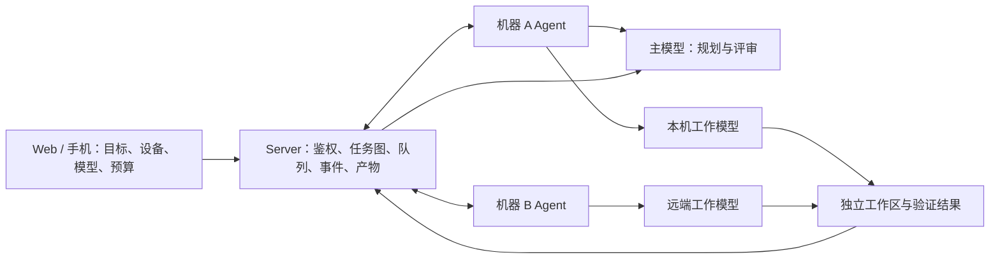

# 单机与多机器、多模型编程调度设计

状态：本机第一版已实现，使用方式及当前限制见 [主 Agent 自主调度](MASTER-AGENT-V1.md)。本文保留后续多机、并行和策略设计；这些扩展尚未实现。沿用现有 Go Server、SQLite 和 Agent 出站 WebSocket 架构。

2026-10-17 的交互决定：用户选择一个主 Agent（CLI / 模型）、项目和目标，主 Agent 自己决定拆分、工作 CLI / 模型、验证与返工。第一版没有要求用户逐一选择规划者、执行者和评审者；高级运行上限和工作模型费用策略折叠展示。

## 1. 总体结构



Server 是调度与权限的权威；Agent 负责本机执行；模型只提出计划、修改代码和评审结果。模型输出不能授予权限、创建未授权的 CLI 配置或决定自己拥有其他账号的设备。主模型可以在任何一台已授权机器上运行，工作模型既可以与主模型同机，也可以位于其他 Agent。跨机器仍复用已有出站连接，不要求家庭电脑增加证书、子域名或入站端口。

## 2. 四种身份必须分开

- Workflow ID：用户的一项总体目标和它的任务图。
- Task ID：一次具体的计划、实现、验证或评审工作。
- Native conversation ID：Codex/Claude/OpenCode 自己保存的对话身份。
- Execution/terminal ID：本次进程、重试和终端查看入口。

恢复一个任务应沿用它的原生对话；新建一个工作任务默认使用新的原生对话，防止不同工作内容污染上下文。进程 ID 可以变化，列表和父子关系不能因此重复。工作区、模型配置、权限策略和输入产物必须有版本，重试不能默默换成最新配置而失去可重现性。

## 3. 模型配置目录

Agent 上报已安装、获准使用的 CLI 和显式配置的模型 profile，例如 `codex-review`、`codex-fast`、`claude-implement`。一个 profile 包含本机 CLI 标识、模型选择、权限与配置引用、能力和账号额度作用域。用户选 profile ID，客户端和主模型不传任意可执行文件、环境变量、Shell 命令行或供应商地址。

凭据留在执行机器：不把 OAuth token、API key、系统钥匙串或整个 CLI home 复制给 Server 或其他 Agent。登录状态、可用模型和额度可能因机器而不同；无法可靠读取时标为未知。订阅账号与 API 账号的计费/额度要分别显示，不能把 token 数伪装成精确费用。

### 免费模型用于开发与执行验证

按用户于 2026-10-17 的选择，开发调度功能时优先使用本机 OpenCode 的免费模型进行真实 CLI/原生接口验证，并把它们作为可选工作模型 profile。主模型仍由用户明确选择；模型是否适合规划、实现或评审，以具体能力和任务验证为依据。

本机已通过 `opencode/mimo-v2.6-flash-free` 验证真实提示词完成、运行中取消、另一会话结果保持和原生费用为零。它是当前验证过的开发入口，不是永久可用的硬编码默认模型。官方免费清单及价格会变动，运行时应从执行机器读取实际目录、工具能力、各价格档和可用状态；只有输入、输出及缓存价格均明确为零时才标记为免费。原生会话费用与目录报价分别记录，不把报价当作已结算账单。

profile 保存明确的 provider/model、能力及计费策略。免费 profile 被限流、下架、认证失效或价格变为非零/未知时暂停派发并展示原因；不得自动换成付费模型。切换其他免费 profile 也要遵循用户选定的候选池和任务配置版本，不能在恢复原生对话时默默改变模型。开发阶段默认串行、短时限、有限重试，以实际返回、产物和取消回执作为证据。

OpenCode V2 的新会话应使用原生服务生成的 Session ID，并保存返回的确切身份；本机对照测试发现，自造 UUID 形式的 `ses_...` 即使被本机 API 接受，仍可能触发免费服务认证错误。模型输出和会话 ID 生成均不替代 CodeGate 的任务幂等回执。

参考：[官方模型和免费价格说明](https://opencode.ai/v2/docs/console/models/)。当前可重复测试入口是 `TestOpenCodeV2FreeModelExecution`，必须显式设置本机可执行文件和免费模型环境变量；普通 CI 不调用托管模型。

## 4. 工作任务契约

任务至少包含：用户、目标设备、项目映射、允许的 profile、任务目标、依赖任务、基线 Git commit/快照 hash、输入产物、允许修改范围、验证要求、并发/运行时间/重试限制、父任务、原生对话绑定和幂等键。

示例（字段由 Server 补齐并验证，而不是照单接收模型生成的数据）：

```json
{
  "schema_version": 1,
  "workflow_id": "workflow-uuid",
  "parent_task_id": "review-task-uuid",
  "device_id": "owned-device-id",
  "project_binding_id": "project-on-device-b",
  "profile_id": "codex-implement",
  "goal": "修复移动端输入延迟，并提交测试证据",
  "base_commit": "full-commit-sha",
  "allowed_paths": ["web/src/", "web/tests/"],
  "depends_on": ["design-task-uuid"],
  "limits": {"max_run_minutes": 90, "max_attempts": 2},
  "acceptance": ["类型检查通过", "移动端回归通过"]
}
```

## 5. 同机执行

不同工作任务使用独立 Git worktree/分支。同一原生对话一次只允许一个执行者，不能让终端、定时续跑和主模型同时往里面发消息。主模型通过结构化操作 `submit_task`、`get_task`、`inspect_artifact`、`request_changes`、`finalize_plan` 管理工作，而不是模拟按键或解析终端画面上的文字。

每个 CLI 用独立适配器，声明 `run/resume/structured_output/quota/cancel` 等实际支持的能力。优先使用稳定 SDK/原生协议；已验证的非交互 CLI 可作为初期适配器。没有能力的 CLI 应明确拒绝该操作，不能偷偷改成新对话或猜测按键。

## 6. 多机器项目与产物

同一个逻辑项目可以映射到不同机器的授权目录。调度前核对仓库身份、基线 commit、工作区版本和工具能力，不能按目录名推断两台机器内容相同。

Git 项目优先传 Git bundle/commit/patch；非 Git 项目使用带清单和 hash 的文件快照。产物有不可变 ID、所属用户、输入/输出 hash、基线和修改范围，限制单个及总大小。默认不复制 Agent 私有状态、CLI home、凭据、缓存和依赖目录；目标机器所需环境由其本机配置提供。解包必须拒绝绝对路径、`..`、逃逸链接和超出项目的写入。

工作模型提交结果到它自己的工作区，不直接改主工作区。主模型/整合任务检查 diff 和验证结果后整合；冲突成为明确任务，不允许无提示覆盖。执行本地命令、推送、合并和发布的权限来自用户项目策略，主模型不能自行扩大。

## 7. 状态、离线和额度

任务状态应区分：排队、等待 Agent、等待额度、等待同一对话空闲、准备派发、执行中、执行结束、失败、取消中、已取消、需要确认。CLI 退出码为零表示一次执行结束，不等同于用户目标已经验收通过；主模型需要依据实际产物和验证证据决定任务图是否完成。

额度等待复用第二期队列。优先使用厂商实际 reset 时间；多个已耗尽窗口应等待全部相关阻塞解除，不能只看五小时窗口而忽略周额度。查询失败或账号/profile 作用域不确定时不能当成余额充足。用户明确选择按时间继续时才使用其等待时长。两台机器使用同一订阅账号时，额度冷却与并发约束需按声明/确认的账号组共享，不能误认为机器不同就有独立额度。

## 8. 交付与恢复

Server 持久化任务与幂等键；Agent 在派发前写入私有执行回执。相同 Task ID 重传不能再次发送同一条模型指令。无法证明派发是否发生时进入“需要确认”，不宣称跨第三方 CLI 实现了严格 exactly-once，也不盲目重放。

Server 重启后通过 Agent 回执/事件序号对账；Agent 重启后不能根据旧 PID 随意杀进程或假装已继续。运行中任务按真实进程与持久化历史恢复，否则标为未知。断开浏览器不影响排队和运行；Agent 离线时等待它上线。取消只停止该任务拥有的进程树，保留已有代码和原生对话；父任务取消需要向子任务传播并显示各机器的实际确认状态。

## 9. 数据模型和协议演进

第二期任务表后续增加父任务、workflow、profile 和项目映射引用；第三期再增加工作流/依赖、事件、产物和设备项目映射表。事件有递增序号，重复消息去重，缺口通过快照恢复。CLI 概要、项目文件和任务输出作为不可信数据处理，不能当作控制指令。

所有新消息都加 Agent capability 门控；旧 Agent 不支持的任务留在等待升级状态，不发送它无法识别的指令。Task 状态响应和通知必须校验设备与账号；Web 切换账号后清空缓存并终止旧账号的后续操作。任务摘要和产物访问按用户/项目授权，模型日志不得进入公共 Agent 日志。

## 10. 运行限制与界面

用户创建工作流时选择主模型、可用工作机器/profile、最大并发、运行时间、重试次数和外部操作权限。订阅类展示额度窗口，API 类在有可信价格/usage 时展示费用；不知道的指标保留“未知”。父模型的计划、各机器的状态、等待原因、修改产物和验证结果可展开查看，手机默认显示总体进度与需要用户处理的事项。

权限在整项工作流范围内保存，不对每个已授权步骤反复确认。超出范围、派发结果不明或实际需要登录时才暂停，让用户处理具体事项。不能用未经验证的本地回显、终端关键词或“看起来完成”代替执行证据。

## 11. 后续分期

1. 基础目录与调度配置：项目映射、profile 目录、能力协商、输入/产物契约。
2. 同机调度：一个主模型管理多个独立工作模型；先实现拆分、执行、验证、评审，不加入跨机传输。
3. 多机调度：基线同步、不可变产物、Agent 选择、离线恢复和跨机器取消。
4. 更完整策略：账号组额度协调、预算、可观测性、优先级和大规模任务图。

每期都用真实 CLI 与本地测试模型验证，先通过本机模式，再扩大到两台隔离 Agent；不能用模拟成功状态冒充实际执行。

## 12. 必须验证的场景

同机与异机正常流程；相同任务重传；Server/Agent 在派发前后分别崩溃；模型撞额度；错误/过期登录；Profile 改动；旧 Agent；目标目录越权；跨账号请求；同一对话已有终端；冲突产物；测试失败；取消部分离线子任务；强制断网；超过运行时间；超出预算；结果包含伪造控制指令。验证应证明代码/原生对话身份一致、无重复模型调用、无不相关进程被关闭、产物未覆盖主工作区。
