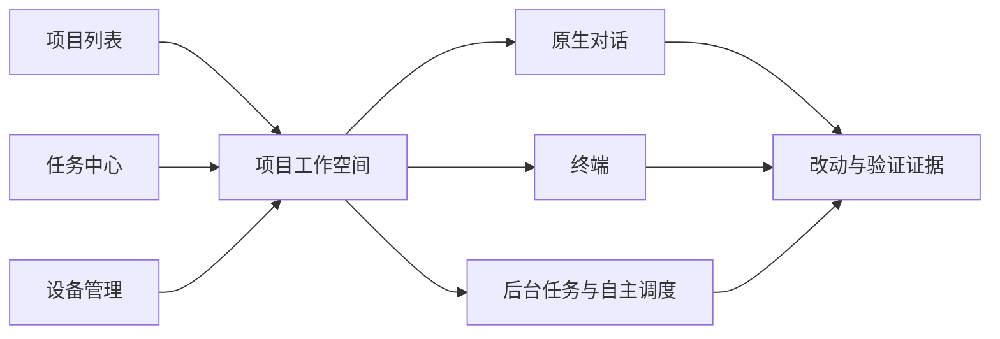

# 工作界面、启动权限与原生 Chat 版本计划

日期：2026-10-26。界面基线：已发布的 v0.1.45。本文件统一后续信息架构、启动权限和 Chat 规划；不表示下述功能已实现，也不授权发布、升级 CLI 或发起模型请求。旧计划的未完事项按本文重新排期，版本号在发布前再次核对。

2026-10-27 进度：用户授权开始下一步后，工作入口阶段已完成本地实现；项目工作空间、任务聚合、手机导航与原有入口兼容的证据见[本地实现及验收](PROJECT-WORKSPACE-2026-10-27.md)。这不代表已发布，也不表示权限或原生 Chat 已实现。

## 1. 结论与当前证据

用户的主要目标是进入项目、继续开发、处理阻塞并核对改动。当前界面按设备和技术功能展开，项目页、设备页和终端页同时承载创建、恢复、后台任务、配置及结果说明，主路径不够明确。应先理清工作空间，再把权限和 Chat 放到同一条启动路径。

这次已完成代码审查及线上只读浏览器检查，没有创建任务、接入用户终端或调用模型。390px 项目页的最近会话占据较大首屏；设备页把会话、两种后台任务、创建表单和设备管理放在一条长页面中。桌面仍有大量重复边框、展开区和说明文字。没有观察到页面横向溢出；“页面很长”本身不作为故障结论。检查期间的初次连接/加载状态不作为持续故障。

| 现有位置 | 当前能力与不足 | 规划处理 |
|---|---|---|
| `ProjectsView.vue` | 最近会话、项目操作、恢复、工作摘要和仓库发现同时出现 | 首页聚焦进入项目；其余移入对应上下文 |
| `DeviceDetailView.vue` | 会话、续跑、工作流、新建表单及设备管理混排 | 工作入口归项目，设备页聚焦连接与管理 |
| `TaskLaunch.vue` | 已有直接打开 CLI / 主 Agent 调度；没有原生 Chat、会话权限档位 | 一个启动入口，按能力逐步显示执行方式与权限 |
| `SessionView.vue` | 已有移动快捷键、恢复和输入保护；顶部工具仍多 | 保留终端能力，按当前工作项呈现相关操作 |
| `QuotaPanel.vue` / `quota.go` | 本机额度可能不同于当前模型；失败原因此前折叠，Go 401/403 解释不准确 | 先修真实状态和恢复提示，再做精简展示 |

## 2. 信息架构与视觉方向

- 全局入口收敛为“项目 / 任务 / 设备”，账号设置放工具菜单。桌面保留稳定导航位置；手机列表和管理页可用三个底部入口，进入具体工作后隐藏全局导航，避免多层导航占满屏幕。
- 项目首页最近工作桌面默认三项、手机默认一项，并提供展开查看更多；项目主操作统一为“进入项目”。完整路径、恢复列表、项目设置和工作摘要在项目内按需展示。“添加项目”再展开仓库发现，不在首页自动启动昂贵扫描。
- 工作空间顶部只保留项目、设备、分支和当前状态的简明上下文。桌面左侧为当前项目工作项，中央为工作内容，右侧按需查看改动/文件；手机用工作项抽屉和互斥内容页，保留明确返回及关闭入口。
- 工作项区分原生对话、终端和后台任务。只有能力与身份均已验证时才提供视图切换，不能把每个终端都包装成可恢复 Chat。
- 使用一个“开始工作”入口，选择“对话协作 / 打开终端 / 自主调度”。首版只有实际支持的方式可选；禁用项说明原因，不添加不能执行的按钮。
- 沿用现有低饱和蓝灰、字体和终端视觉，减少同等重量的卡片与重复说明。靠间距、文字层级和稳定的主操作建立秩序，不增加闪烁、装饰性仪表盘或密集状态徽章。
- 常态只展示简短状态；异常就地显示原因、影响与恢复动作。详细路径、原始日志、额度窗口、设备维护归二级内容，取消与权限等待不能被隐藏。

## 3. 任务中心和交付回访

任务中心按“进行中 / 需要处理 / 已预约 / 历史”组织，保留续跑、一次执行、工作流的来源类型。聚合现有记录和操作，不再生成第二套执行事实。跨设备读取失败显示结果不完整；不能由空回包推断全部完成。

每项提供设备、项目、阶段、等待原因和“查看并处理”。活动任务显示取消入口；取消请求已发出与执行已停止分别表达。收起历史不等于取消任务，删除展示记录不删除原生对话或代码。

返回工作空间时恢复已存在的草稿和阅读位置；交付区展示改动、验证命令及结果、原生执行状态和人工核对入口。模型说完成、进程退出、自动检查通过、评审通过和用户验收分别记录。部分结果、离线缓存及结果不明保留证据，不自动重派发。

## 4. 打开终端时预选权限

用户于 2026-10-27 明确：这是 CLI 自带 TUI 权限模式的启动预选，用原生启动参数提前选好，不是 CodeGate 新建自定义权限策略。本轮实现和调查见[原生模式及 Chat 接入记录](NATIVE-CLI-MODES-AND-CHAT-2026-10-27.md)。

- 默认继承 CLI 本机设置；只在本次新建终端时传参数，切换工具、重新打开启动面板会清空选择。失败保留输入和模式，不能静默换成其他权限。
- Codex 提供原生只读、工作区读写、自动审批和完全权限；Claude 提供其原生手动、Plan、自动接受编辑、Auto、不询问及完全权限。完全权限必须明确选择，不记为通用默认。
- OpenCode 2 目前提供已核实的 `--auto`；DSH 未核实到等价 TUI 启动参数，保留继承和明确说明，不用自定义规则、审批插件或提示词伪装原生模式。
- 浏览器只发枚举 ID，Server 校验设备、Agent 能力与命令清单，Agent 映射固定原生参数。命令已有本机固定参数时不开放覆盖；旧 Agent 不会静默忽略选择。
- 不改全局配置、不预创建原生对话、不新增权限执行层；既有恢复行为保持原样，不强制回放上一次启动选择。原生模式仍可在 CLI 自己的 TUI 中切换，模型与费用策略继续沿用本机设置。

原生只读、Plan、自动和完全权限各有 CLI 自己的语义，不宣称所有工具等价。`allowed_roots` 仍只约束终端启动目录，不将它表达成 CLI 子进程沙箱。

## 5. Chat 的产品边界

Chat 直接控制本机 CLI 的原生对话，沿用本机模型、凭据和执行能力。结构化显示消息、工具执行、审批/提问、改动和验证证据；终端仍保留完整 TUI。不能把 ANSI 终端输出切成气泡就宣称接入了原生对话。

首版从 CodeGate 新建、拥有明确 native ID 的 Codex 对话开始，完成以下闭环再开放入口：

1. 创建与继续同一原生对话，分页读取历史，流式更新文本和工具状态。
2. 原生权限申请和用户问题转为可触摸、可键盘操作的卡片；显示授权范围、实际待确认动作与有效状态。
3. 停止当前执行，收到原生回执后显示已停止；保留部分内容和已产生的代码。
4. 刷新/重连后用原生 ID、turn/item ID 和事件边界核对历史、运行状态及未决审批；结果不明先确认，不盲目重发。
5. 草稿按账号/项目/对话隔离，失败保留输入；附件复用已有上传能力，按原生协议和大小限制逐步开放。
6. 交付区可查看实际改动和验证证据，分别表示“执行结束”和“等待人工核对”。

首版不自动接管任意现存 TUI。Chat 与 TUI 交接需要确切 native ID、空闲状态、未发送输入处理及单写者所有权均有证据；不能两边同时发送。CodeGate 内部租约只能管理自身客户端，仍需核对原生忙碌状态，不能声称锁住外部工具。

## 6. 原生适配与可靠性约束

本机只读版本核对：Codex `0.164.0`、OpenCode `2.0.32`、Claude Code `2.1.240`、DSH `0.2.1-rc.2`。这些版本和接口调研不等于已完成模型运行验收。

| CLI | 已有依据 | Chat 接入次序与限制 |
|---|---|---|
| Codex | 本机生成 schema 包含 thread/turn、消息增量、原生审批和用户提问 | 第一阶段；仍需真实握手及隔离模型闭环 |
| OpenCode V2 | 已有本地服务连接及原生执行接口；HTTP API 为实验接口，SSE 非持久事件日志 | 第二阶段；固定服务版本，断线后对账历史和待决请求 |
| Claude Code | 当前安装版本具备 print/结构化流接口 | 单独验证原生审批、权限及恢复后开放；不套用较新版本参数 |
| DSH | ACP 文档提供更新、审批、取消及恢复 | 后续验证；ACP resume 不回放历史，历史来源未解决前不能承诺完整恢复 Chat |

`live_quota.go` 的 Codex 查询客户端同步等待特定响应，会跳过异步通知和 Server 请求，不能直接用作 Chat。需增加长期读取循环、响应/通知/审批分发、串行写入、待决请求及重连清理。复用本地连接发现，不重启或停止用户共享守护服务。

Agent 保存原生身份及必要事件/派发凭证；Server 保存授权、任务元数据和派发回执。默认按需从在线 Agent 分页读取原生历史，不静默上传全部 CLI 对话；设备离线时只能显示已加载缓存及其时间。后续离线历史缓存另行明确选择与保留策略。

派发前持久化 attempt ID 和接收状态，接收后绑定 native/turn/request ID；不能假设某个客户端消息字段天然提供幂等。断线、取消、过期 epoch 之后的回包不能覆盖新状态或批准旧请求。审批必须绑定仍有效的原生请求，并确认回执；免费模型不能静默回退付费模型。

Chat 与自主调度共享逐步收敛的底层适配能力，产品入口和授权目的保持区分；不要求先重写整个跨机调度系统才能交付首版 Chat。

## 7. 本次 OpenCode 故障与性能调查

额度：当前 CodeGate 读取旧 `auth.json` 的 `opencode-go` API Key；只读请求明确收到 `api_key_expired`。无明确客户端标识的探针还收到过边缘层 403，不能直接推断未订阅。带 CodeGate 客户端标识、使用当前 canonical usage URL 后得到明确 401。V2 本地数据库还保留了同一旧 Go Key，不能由此推断全部当前模型连接的账号状态。

本地修复：优先只读 V2 凭据表中明确活动的 Go Key，单个迁移凭据仍兼容；多个候选无明确活动项时要求用户确认，V2 已删除 Go 配置时不退回旧文件。V1 保留旧文件读取，环境变量优先级不变。迁移至 `/inference/go/v1/usage`，请求声明客户端；按白名单错误码解释过期 Key，不透传供应商错误正文；403 表示无法确认订阅状态；页面直接显示失败原因和恢复路径，缺失值不显示为 0 或 100%。更换凭据后需等待缓存到期再刷新。新 Key 由用户在本机 OpenCode 中配置，不进入聊天、Server 或日志。

真实成功额度尚未验收：现有 Go Key 已过期，没有更换凭据或发起模型调用。安装的 2.0.32 本地 OpenAPI 没有当前文档中的 `/api/experimental/usage/limits`，现场 GET 返回 404；不能凭新版文档宣称原生额度接口已可用。Console workspace/OAuth 的额度与 Go API Key 是不同来源，后续按原生能力分别适配，不能把其中一个账号状态当成所有当前模型状态。

卡顿：用户反馈本机及网页都有感受。官方实现分别使用 OpenTUI 和 Ratatui，CodeGate 都经 ConPTY → Agent/Server WebSocket → xterm，尝试加载 WebGL，失败时回退。重绘、传输与浏览器解析可能叠加，但框架区别不能证明瓶颈。

短时本机 CPU 采样未见单核打满，不能排除瞬时卡顿。最近日志尾部包含过期 Key 和超时记录，尚未逐次对应用户操作；本地历史库接近 1GB，不构成“库太大所以卡”的因果证据。未清理、压缩、迁移数据库，未停止服务或修改用户动画设置。

下一步在隔离会话分别测量：无模型请求的输入/滚动/长历史重放；本机与 CodeGate 相同终端尺寸下的输出字节率、帧数、解析积压、长任务和输入回显；请求被接受、收到响应头、首个 token、工具等待及执行完成的时间。诊断只记计数和时长，不保存提示词、终端内容或凭据。先证明瓶颈，再决定减少动画、合并传输或调优渲染；不能丢弃 ANSI 字节、破坏序号和恢复边界来换取帧率。

## 8. 建议版本顺序

| 候选版本 | 交付边界 | 发布前门槛 |
|---|---|---|
| v0.1.46 维护 | Go 额度失败解释与恢复；卡顿定位后仅合入有证据的独立修复 | 额度正常/失效/拒绝/更换凭据恢复；性能未定位不宣称解决 |
| v0.1.47 工作入口 | 项目工作空间、统一启动入口、任务聚合入口和设备页职责调整 | 旧链接可用，任务不重复，草稿与返回位置保留，手机与键盘关键路径 |
| v0.1.48 原生启动模式 | 将各 CLI 自带模式映射为本次启动参数 | 参数与真实 CLI 核对、失败保留输入、旧 Agent 拒绝静默忽略；不新增自定义策略 |
| v0.1.49 Codex Chat | 消息/工具/审批/停止/历史恢复的最小完整闭环 | 原生身份与事件对账、取消与断线恢复、隔离模型真实验收 |
| v0.1.50 及后续 | OpenCode V2 Chat 和交付回访，逐个推进其他 CLI | 每个 CLI 独立能力与权限验收，不因已安装就标记支持 |

以上是排期建议，未开始项不标记交付。旧计划的待处理汇总并入工作入口，交付回访贯穿工作空间和 Chat；统一 CLI 能力契约按适配阶段推进。版本被紧急修复占用时重新编号，不能用发布号判断功能是否完成。

## 9. 验收与设计心理学

- 正常、首次加载、真实空数据、离线、部分读取失败和重试分别检查；上次结果必须说明时间与来源。
- 异步路径覆盖取消前/中/后、派发无回执、刷新、断线重连、重复事件、旧响应和已失效审批；不能靠盲目重放恢复。
- 界面覆盖 320/390/430px、桌面、200% 缩放、长路径/模型名、Tab/Enter/Escape、焦点返回、读屏状态和减少动效。真实 Android/iPhone 软键盘、触摸与系统返回另记验收，不以模拟视口替代。
- 保留已产生代码及证据；删除历史与取消执行分开。验证权限、费用策略、跨账号隔离和凭据不外泄。
- 首先让用户知道“在哪里工作、正在做什么、为什么等、如何继续或停止”；高级能力按任务展开，视觉克制，结果可核对。每版记录自动化、真实流程及未验收项，不以构建成功替代用户体验验收。

本轮额度回归先验证旧实现失败，再实现；Go 额度针对性测试、前端 UX 回归与类型检查/生产构建已通过。2026-10-27 跨日完成隔离浏览器 24 项检查：320/390/1440px、过期原因直接显示、等待状态、键盘刷新、成功数值、重载、后续失败清除旧数值、窄屏及抽屉焦点返回。使用模拟 HTTP/WebSocket，未接入真实模型。真实有效 Key、完整模型请求、卡顿复现和移动实机尚未验收。工作空间已本地实现；原生启动模式与 Chat 隔离协议证据见本轮记录，Chat 生产入口未开发；均未提交或发布。

## 10. 一手资料

- [Codex App Server：线程、事件、审批与历史](https://learn.chatgpt.com/docs/app-server)，并以本机 0.164.0 生成 schema 交叉核对。
- [OpenCode V2 API](https://opencode.ai/v2/docs/api)、[V2 权限](https://opencode.ai/v2/docs/permissions/)、[Go 配置](https://opencode.ai/v2/docs/console/go/)；已安装版本与当前文档分别验证。
- [OpenCode 维护者的 Go canonical endpoint 说明](https://github.com/anomalyco/opencode/issues/52227)；实现仅使用只读 usage 查询，未发起推理。
- [Claude 非交互接口](https://code.claude.com/docs/en/headless)、[权限](https://code.claude.com/docs/en/permissions)。
- [DSH ACP 接口](https://github.com/deepseek-ai/deepseek-harness/blob/master/packages/acp/acp/README.md)，上游文档不代替安装版本验收。
- [OpenTUI](https://github.com/anomalyco/opentui)、[Codex TUI 依赖](https://github.com/openai/codex/blob/main/codex-rs/tui/Cargo.toml)、[OpenCode V2 CLI 设置](https://opencode.ai/v2/docs/cli/config)。
- [Web Interface Guidelines](https://github.com/vercel-labs/web-interface-guidelines/blob/main/command.md)，用于标签、焦点、等待反馈和窄屏验收。
